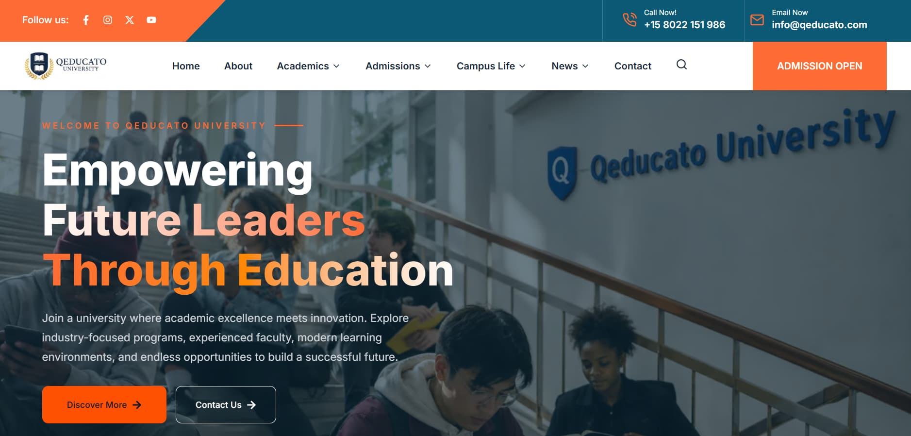

 
 <div align="center">
  <h1>Qeducato University</h1>
  <p><strong>Modern University Website & Digital Education Experience</strong></p>
  <p>
    A comprehensive university website designed to bring admissions, academic programs, faculty information, tuition fees, campus life, and student resources together in one digital experience.
  </p>
  <p>
    <a href="https://qeducato.vercel.app/">Live Website</a>
  </p>
</div>

---

## About The Project

Qeducato is a modern university website built with Next.js to provide students, prospective applicants, faculty members, and visitors with an accessible and engaging digital experience.

The platform brings essential university information into one place, including online admission information, academic programs, tuition and fee details, faculty and staff profiles, campus facilities, student clubs, events, and educational blog content.

The project focuses on a professional user interface, responsive layouts, intuitive navigation, and a seamless experience across devices.

## Features

- **University Overview:** Explore the university, its mission, academic strengths, and facilities.
- **Admissions:** Access admission information and application guidance.
- **Academic Programs:** Discover available courses and educational opportunities.
- **Tuition & Fees:** Explore tuition structures, fee information, and scholarship opportunities.
- **Faculty & Staff:** Learn about educators, academic professionals, and university staff.
- **Campus Life:** Discover campus facilities, student activities, and the university environment.
- **Student Clubs:** Explore extracurricular activities and student communities.
- **Events & Activities:** Stay informed about academic events, workshops, and university activities.
- **Educational Blog:** Read articles, academic insights, career advice, and educational updates.
- **Student Support:** Find answers to frequently asked questions and access support information.
- **Responsive Design:** Optimized layouts for desktop, tablet, and mobile devices.
- **Modern UI/UX:** Clean design, structured content, and intuitive navigation.

## Tech Stack

- **Next.js** — React framework for building the website.
- **React** — Component-based user interface development.
- **JavaScript** — Application logic and interactivity.
- **Tailwind CSS** — Utility-first styling, if used in the project.

## Getting Started

### Prerequisites

- Node.js
- npm
- Git

### Installation

Clone the repository:

```bash
git clone YOUR_GITHUB_REPOSITORY_URL
```

Navigate to the project directory:

```bash
cd YOUR_PROJECT_FOLDER
```

Install dependencies:

```bash
npm install
```

Start the development server:

```bash
npm run dev
```

Open [http://localhost:3000](http://localhost:3000) in your browser.

## Project Goals

- Make university information easy to discover.
- Simplify access to admission and tuition information.
- Present academic departments, faculty, and campus facilities clearly.
- Improve the digital experience for prospective and current students.
- Provide a scalable foundation for additional student services and university management features.

## Future Enhancements

- Student admission application portal
- Secure online tuition fee payments
- Student and administrator dashboards
- Application status tracking
- Academic records and course management
- Enhanced student club and event management

*Future enhancements are planned features, not necessarily implemented functionality.*

## Live Demo

Explore the website:

**[https://qeducato.vercel.app/](https://qeducato.vercel.app/)**

## Author

**Al Mahmud**

- GitHub: [@almahmud-dev](https://github.com/almahmud-dev)

---

<div align="center">
  <p><strong>Built with Next.js</strong></p>
  <sub>Bringing university information and digital education experiences together.</sub>
</div>
